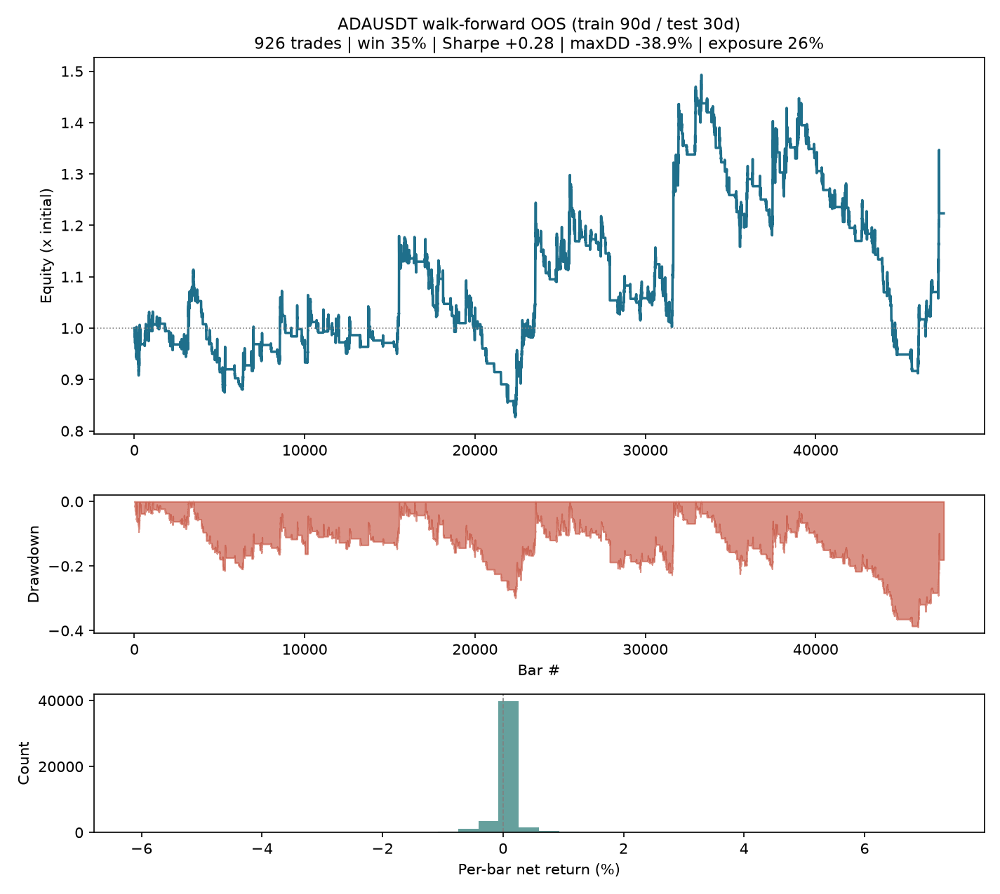
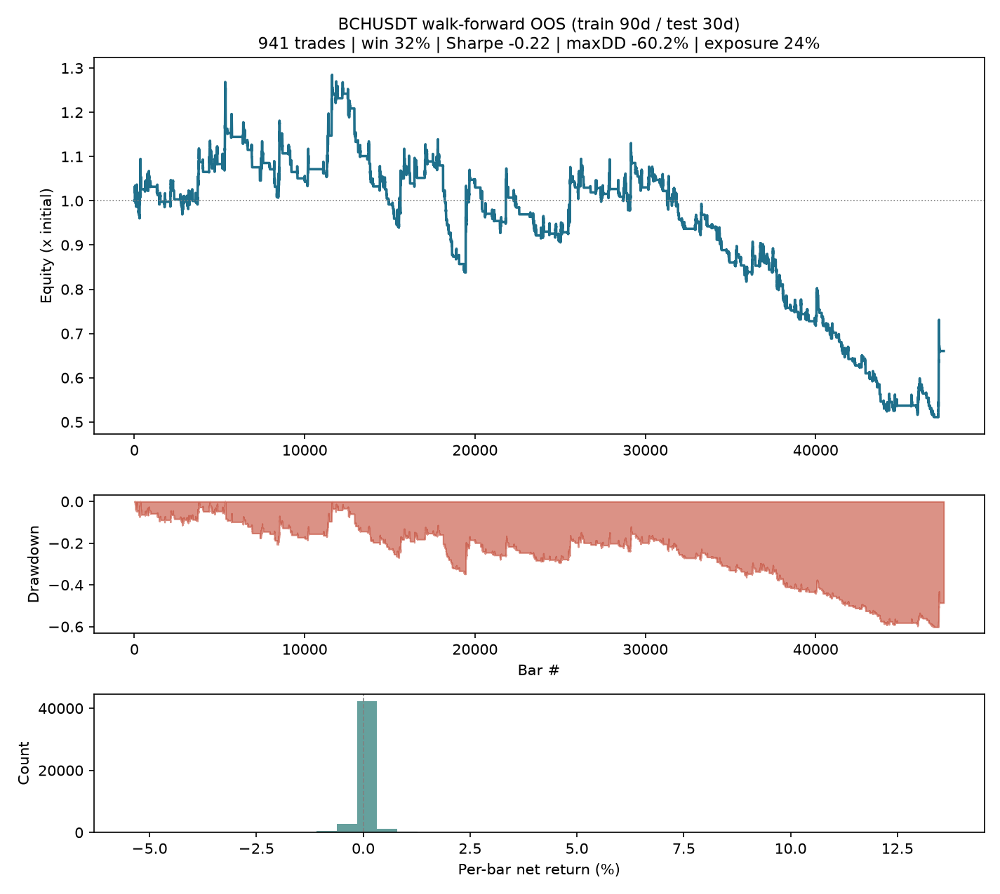
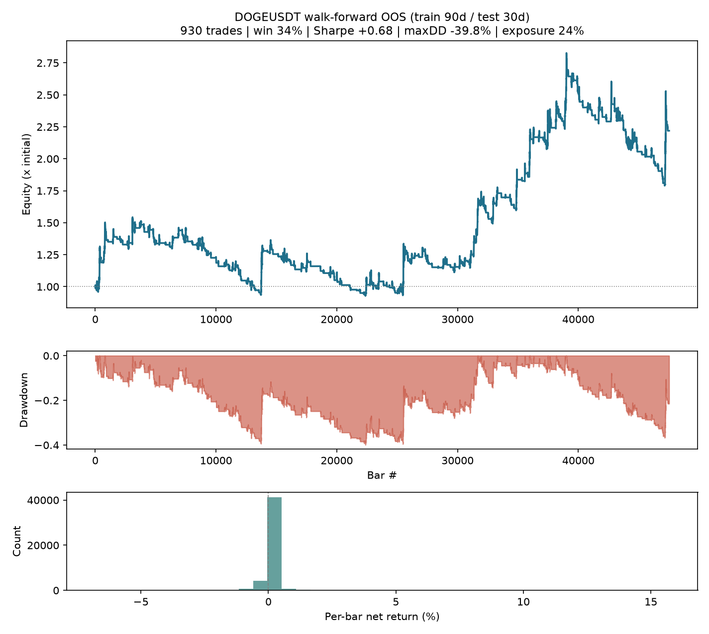
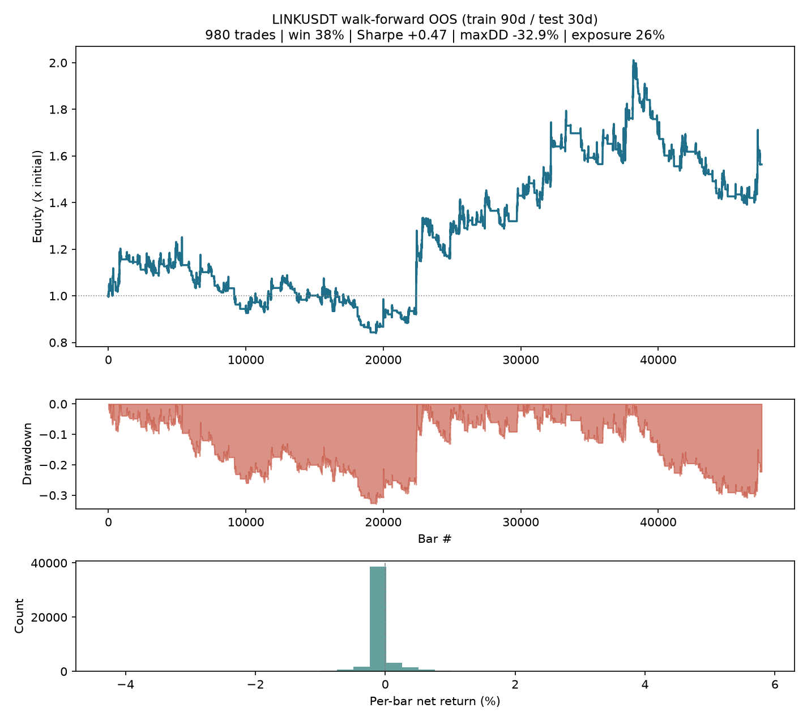
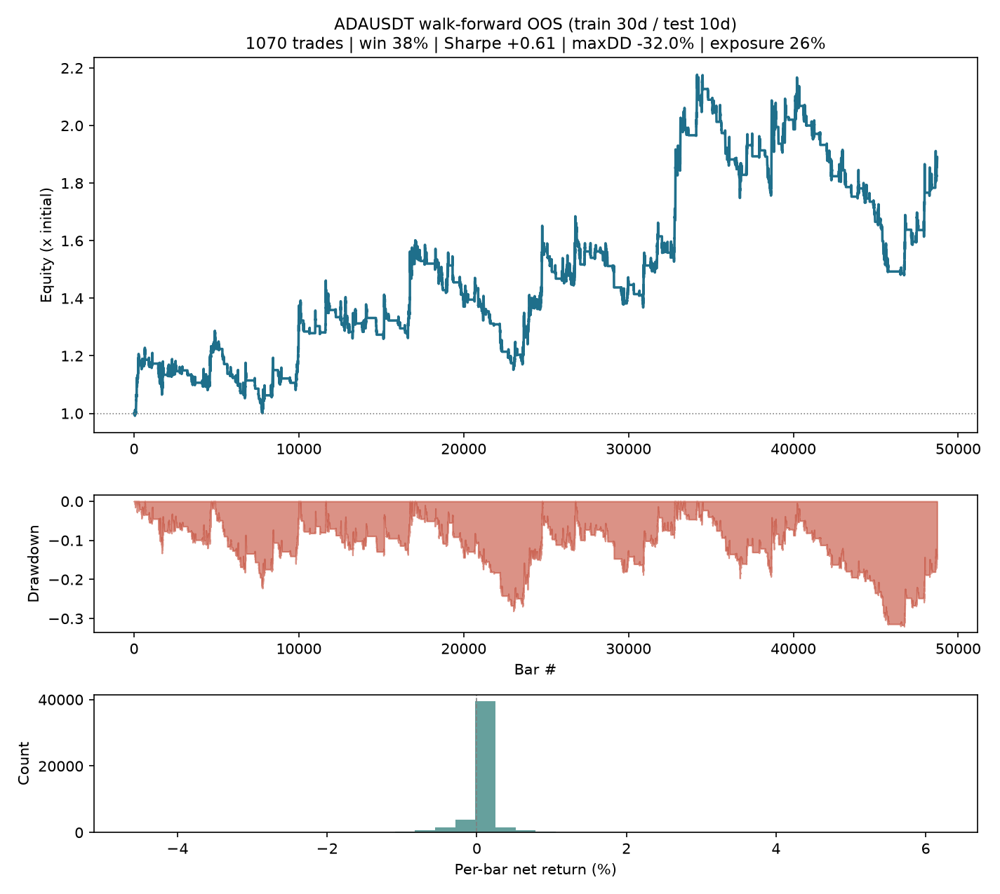
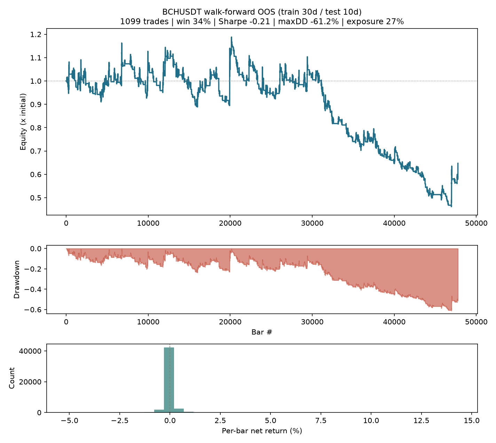
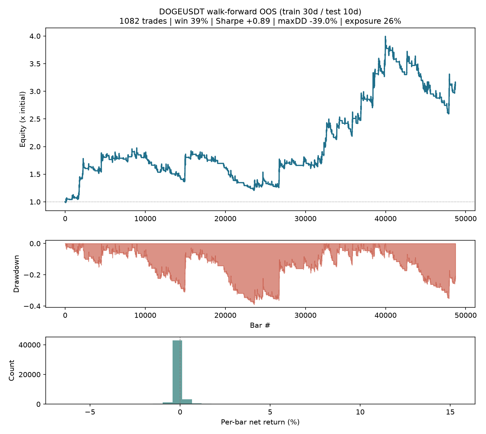
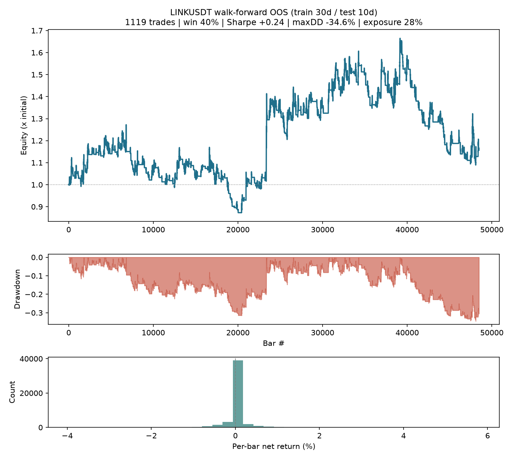

# Validation report

- Data window: `20210101_20261001` (start inclusive, end exclusive), 60m bars aggregated from 1m klines
- Symbols: NEARUSDT, ETHUSDT, SOLUSDT, BTCUSDT, BCHUSDT, DOGEUSDT, ADAUSDT, LINKUSDT
- Engine: walk-forward, Sharpe selection over 12 grid cells, top-3 ensemble; risk overlay OFF (pure engine)
- Costs: taker fee 0.100% + slippage 0.020% per side
- Bootstrap: 10,000 circular-block resamples, block 168 bars, seed 7, 95% percentile CIs
- Deflated Sharpe: N = trials ledger stats.TRIALS_TRIED = 219; trial-Sharpe variance from the 12 grid cells traded as fixed configs on the same OOS bars
- BTC regime: chop if ER(48) < 0.2, else up/down vs SMA(200); label lagged one bar; descriptive only, never a signal

## Window variant: train 90d / test 30d

### NEARUSDT (production)

- OOS bars 47,520, trades 981, **independent decisions N_eff = 331**
- Sharpe (ann.): +0.35  95% CI [-0.50, +1.17]
- Annualised return: +5.81%  95% CI [-13.25%, +29.09%]
- Max drawdown: -41.55%  95% CI [-66.17%, -23.78%]
- Total return: +35.82%
- Expectancy / decision: +0.132%  95% CI [-0.204%, +0.484%]
- Deflated Sharpe: P(SR > SR*) = 0.277, excess over benchmark -0.25 (SR* +0.61 ann., N trials 219)
- Windows: 66/66 traded
- BTC regime at the previous close (descriptive, not a signal):
  - up  :  7,765 bars (16%), return +17.96%, Sharpe +0.70
  - chop: 32,904 bars (69%), return +4.22%, Sharpe +0.16
  - down:  6,851 bars (14%), return +10.48%, Sharpe +0.88
- OOS equity: 
- **Verdict: This result is not statistically distinguishable from noise at this sample size. (Sharpe CI includes zero; annualised-return CI includes zero; per-decision expectancy CI includes zero; deflated Sharpe <= 0 (no excess over the selection-bias benchmark))**

### ADAUSDT

- OOS bars 47,520, trades 926, **independent decisions N_eff = 288**
- Sharpe (ann.): +0.28  95% CI [-0.61, +1.11]
- Annualised return: +3.79%  95% CI [-14.38%, +27.17%]
- Max drawdown: -38.90%  95% CI [-68.21%, -24.79%]
- Total return: +22.35%
- Expectancy / decision: +0.135%  95% CI [-0.267%, +0.564%]
- Deflated Sharpe: P(SR > SR*) = 0.343, excess over benchmark -0.17 (SR* +0.45 ann., N trials 219)
- Windows: 66/66 traded
- BTC regime at the previous close (descriptive, not a signal):
  - up  :  7,765 bars (16%), return -4.23%, Sharpe +0.09
  - chop: 32,904 bars (69%), return +23.97%, Sharpe +0.40
  - down:  6,851 bars (14%), return +3.05%, Sharpe +0.57
- OOS equity: 
- **Verdict: This result is not statistically distinguishable from noise at this sample size. (Sharpe CI includes zero; annualised-return CI includes zero; per-decision expectancy CI includes zero; deflated Sharpe <= 0 (no excess over the selection-bias benchmark))**

### BCHUSDT

- OOS bars 47,520, trades 941, **independent decisions N_eff = 326**
- Sharpe (ann.): -0.22  95% CI [-1.17, +0.63]
- Annualised return: -7.36%  95% CI [-22.96%, +12.86%]
- Max drawdown: -60.22%  95% CI [-80.09%, -31.67%]
- Total return: -33.95%
- Expectancy / decision: -0.090%  95% CI [-0.401%, +0.251%]
- Deflated Sharpe: P(SR > SR*) = 0.092, excess over benchmark -0.57 (SR* +0.35 ann., N trials 219)
- Windows: 66/66 traded
- BTC regime at the previous close (descriptive, not a signal):
  - up  :  7,765 bars (16%), return +20.64%, Sharpe +0.72
  - chop: 32,904 bars (69%), return -47.28%, Sharpe -0.84
  - down:  6,851 bars (14%), return +3.85%, Sharpe +0.69
- OOS equity: 
- **Verdict: This result is not statistically distinguishable from noise at this sample size. (Sharpe CI includes zero; annualised-return CI includes zero; per-decision expectancy CI includes zero; deflated Sharpe <= 0 (no excess over the selection-bias benchmark))**

### DOGEUSDT

- OOS bars 47,520, trades 930, **independent decisions N_eff = 316**
- Sharpe (ann.): +0.68  95% CI [-0.28, +1.54]
- Annualised return: +15.83%  95% CI [-9.10%, +49.84%]
- Max drawdown: -39.83%  95% CI [-64.59%, -24.99%]
- Total return: +121.94%
- Expectancy / decision: +0.360%  95% CI [-0.105%, +0.867%]
- Deflated Sharpe: P(SR > SR*) = 0.863, excess over benchmark +0.46 (SR* +0.21 ann., N trials 219)
- Windows: 66/66 traded
- BTC regime at the previous close (descriptive, not a signal):
  - up  :  7,765 bars (16%), return +90.92%, Sharpe +1.67
  - chop: 32,904 bars (69%), return +12.17%, Sharpe +0.25
  - down:  6,851 bars (14%), return +3.64%, Sharpe +0.72
- OOS equity: 
- **Verdict: This result is not statistically distinguishable from noise at this sample size. (Sharpe CI includes zero; annualised-return CI includes zero; per-decision expectancy CI includes zero)**

### ETHUSDT

- OOS bars 47,520, trades 1114, **independent decisions N_eff = 357**
- Sharpe (ann.): +0.27  95% CI [-0.62, +1.13]
- Annualised return: +3.68%  95% CI [-14.46%, +26.26%]
- Max drawdown: -44.67%  95% CI [-68.49%, -24.14%]
- Total return: +21.68%
- Expectancy / decision: +0.098%  95% CI [-0.206%, +0.424%]
- Deflated Sharpe: P(SR > SR*) = 0.227, excess over benchmark -0.32 (SR* +0.59 ann., N trials 219)
- Windows: 66/66 traded
- BTC regime at the previous close (descriptive, not a signal):
  - up  :  7,765 bars (16%), return +60.23%, Sharpe +1.51
  - chop: 32,904 bars (69%), return -14.62%, Sharpe -0.14
  - down:  6,851 bars (14%), return -11.05%, Sharpe -2.38
- OOS equity: 
- **Verdict: This result is not statistically distinguishable from noise at this sample size. (Sharpe CI includes zero; annualised-return CI includes zero; per-decision expectancy CI includes zero; deflated Sharpe <= 0 (no excess over the selection-bias benchmark))**

### LINKUSDT

- OOS bars 47,520, trades 980, **independent decisions N_eff = 336**
- Sharpe (ann.): +0.47  95% CI [-0.35, +1.24]
- Annualised return: +8.59%  95% CI [-9.67%, +32.44%]
- Max drawdown: -32.91%  95% CI [-60.11%, -21.54%]
- Total return: +56.36%
- Expectancy / decision: +0.163%  95% CI [-0.142%, +0.504%]
- Deflated Sharpe: P(SR > SR*) = 0.579, excess over benchmark +0.09 (SR* +0.38 ann., N trials 219)
- Windows: 66/66 traded
- BTC regime at the previous close (descriptive, not a signal):
  - up  :  7,765 bars (16%), return -2.19%, Sharpe +0.12
  - chop: 32,904 bars (69%), return +45.32%, Sharpe +0.57
  - down:  6,851 bars (14%), return +10.01%, Sharpe +1.41
- OOS equity: 
- **Verdict: This result is not statistically distinguishable from noise at this sample size. (Sharpe CI includes zero; annualised-return CI includes zero; per-decision expectancy CI includes zero)**

### SOLUSDT

- OOS bars 47,520, trades 995, **independent decisions N_eff = 328**
- Sharpe (ann.): +0.47  95% CI [-0.37, +1.26]
- Annualised return: +8.80%  95% CI [-10.58%, +33.62%]
- Max drawdown: -43.21%  95% CI [-62.49%, -22.43%]
- Total return: +58.02%
- Expectancy / decision: +0.181%  95% CI [-0.166%, +0.552%]
- Deflated Sharpe: P(SR > SR*) = 0.320, excess over benchmark -0.20 (SR* +0.67 ann., N trials 219)
- Windows: 66/66 traded
- BTC regime at the previous close (descriptive, not a signal):
  - up  :  7,765 bars (16%), return -0.24%, Sharpe +0.19
  - chop: 32,904 bars (69%), return +61.98%, Sharpe +0.73
  - down:  6,851 bars (14%), return -2.20%, Sharpe -0.17
- OOS equity: 
- **Verdict: This result is not statistically distinguishable from noise at this sample size. (Sharpe CI includes zero; annualised-return CI includes zero; per-decision expectancy CI includes zero; deflated Sharpe <= 0 (no excess over the selection-bias benchmark))**

### POOLED (equal weight: NEARUSDT + ETHUSDT + SOLUSDT + BCHUSDT + DOGEUSDT + ADAUSDT + LINKUSDT; BTCUSDT excluded)

- OOS bars 47,520, trades 6867, **independent decisions N_eff = 387**
- Sharpe (ann.): +0.52  95% CI [-0.36, +1.36]
- Annualised return: +7.14%  95% CI [-5.78%, +23.02%]
- Max drawdown: -25.27%  95% CI [-45.94%, -15.29%]
- Total return: +45.37%
- Expectancy / decision: +0.117%  95% CI [-0.076%, +0.328%]
- Deflated Sharpe: P(SR > SR*) = 0.729, excess over benchmark +0.26 (SR* +0.26 ann., N trials 219)
- BTC regime at the previous close (descriptive, not a signal):
  - up  :  7,765 bars (16%), return +26.83%, Sharpe +1.06
  - chop: 32,904 bars (69%), return +11.71%, Sharpe +0.31
  - down:  6,851 bars (14%), return +2.61%, Sharpe +0.75
- **Verdict: This result is not statistically distinguishable from noise at this sample size. (Sharpe CI includes zero; annualised-return CI includes zero; per-decision expectancy CI includes zero)**

### BTCUSDT (context stream, kept out of the pool)

- OOS bars 47,520, trades 974, **independent decisions N_eff = 320**
- Sharpe (ann.): -0.20  95% CI [-1.20, +0.75]
- Annualised return: -5.74%  95% CI [-21.71%, +14.15%]
- Max drawdown: -48.38%  95% CI [-78.03%, -28.85%]
- Total return: -27.45%
- Expectancy / decision: -0.059%  95% CI [-0.380%, +0.290%]
- Deflated Sharpe: P(SR > SR*) = 0.093, excess over benchmark -0.57 (SR* +0.37 ann., N trials 219)
- Windows: 66/66 traded
- BTC regime at the previous close (descriptive, not a signal):
  - up  :  7,765 bars (16%), return +98.53%, Sharpe +2.08
  - chop: 32,904 bars (69%), return -62.44%, Sharpe -1.97
  - down:  6,851 bars (14%), return -2.69%, Sharpe -1.22
- OOS equity: 
- **Verdict: This result is not statistically distinguishable from noise at this sample size. (Sharpe CI includes zero; annualised-return CI includes zero; per-decision expectancy CI includes zero; deflated Sharpe <= 0 (no excess over the selection-bias benchmark))**

## Window variant: train 30d / test 10d

### NEARUSDT (production)

- OOS bars 48,720, trades 1153, **independent decisions N_eff = 389**
- Sharpe (ann.): +0.53  95% CI [-0.27, +1.28]
- Annualised return: +10.40%  95% CI [-8.32%, +33.38%]
- Max drawdown: -29.28%  95% CI [-59.52%, -21.66%]
- Total return: +73.35%
- Expectancy / decision: +0.181%  95% CI [-0.105%, +0.488%]
- Deflated Sharpe: P(SR > SR*) = 0.325, excess over benchmark -0.19 (SR* +0.72 ann., N trials 219)
- Windows: 203/206 traded
- BTC regime at the previous close (descriptive, not a signal):
  - up  :  8,171 bars (17%), return +9.90%, Sharpe +0.46
  - chop: 33,668 bars (69%), return +49.55%, Sharpe +0.58
  - down:  6,881 bars (14%), return +5.47%, Sharpe +0.56
- OOS equity: 
- **Verdict: This result is not statistically distinguishable from noise at this sample size. (Sharpe CI includes zero; annualised-return CI includes zero; per-decision expectancy CI includes zero; deflated Sharpe <= 0 (no excess over the selection-bias benchmark))**

### ADAUSDT

- OOS bars 48,720, trades 1070, **independent decisions N_eff = 346**
- Sharpe (ann.): +0.61  95% CI [-0.22, +1.43]
- Annualised return: +12.13%  95% CI [-7.40%, +36.47%]
- Max drawdown: -32.01%  95% CI [-58.13%, -21.09%]
- Total return: +89.02%
- Expectancy / decision: +0.226%  95% CI [-0.080%, +0.560%]
- Deflated Sharpe: P(SR > SR*) = 0.681, excess over benchmark +0.20 (SR* +0.41 ann., N trials 219)
- Windows: 203/206 traded
- BTC regime at the previous close (descriptive, not a signal):
  - up  :  8,182 bars (17%), return -16.54%, Sharpe -0.30
  - chop: 33,671 bars (69%), return +108.69%, Sharpe +1.08
  - down:  6,867 bars (14%), return +8.53%, Sharpe +1.44
- OOS equity: 
- **Verdict: This result is not statistically distinguishable from noise at this sample size. (Sharpe CI includes zero; annualised-return CI includes zero; per-decision expectancy CI includes zero)**

### BCHUSDT

- OOS bars 47,760, trades 1099, **independent decisions N_eff = 363**
- Sharpe (ann.): -0.21  95% CI [-1.10, +0.60]
- Annualised return: -7.67%  95% CI [-23.09%, +13.21%]
- Max drawdown: -61.17%  95% CI [-80.69%, -32.60%]
- Total return: -35.28%
- Expectancy / decision: -0.087%  95% CI [-0.383%, +0.242%]
- Deflated Sharpe: P(SR > SR*) = 0.108, excess over benchmark -0.53 (SR* +0.32 ann., N trials 219)
- Windows: 199/206 traded
- BTC regime at the previous close (descriptive, not a signal):
  - up  :  8,006 bars (17%), return +11.17%, Sharpe +0.48
  - chop: 33,119 bars (69%), return -42.25%, Sharpe -0.64
  - down:  6,635 bars (14%), return +0.81%, Sharpe +0.18
- OOS equity: 
- **Verdict: This result is not statistically distinguishable from noise at this sample size. (Sharpe CI includes zero; annualised-return CI includes zero; per-decision expectancy CI includes zero; deflated Sharpe <= 0 (no excess over the selection-bias benchmark))**

### DOGEUSDT

- OOS bars 48,720, trades 1082, **independent decisions N_eff = 367**
- Sharpe (ann.): +0.89  95% CI [-0.02, +1.71]
- Annualised return: +22.93%  95% CI [-3.33%, +58.89%]
- Max drawdown: -38.96%  95% CI [-58.50%, -22.48%]
- Total return: +215.19%
- Expectancy / decision: +0.393%  95% CI [+0.025%, +0.802%]
- Deflated Sharpe: P(SR > SR*) = 0.949, excess over benchmark +0.68 (SR* +0.21 ann., N trials 219)
- Windows: 203/206 traded
- BTC regime at the previous close (descriptive, not a signal):
  - up  :  8,172 bars (17%), return +108.13%, Sharpe +1.80
  - chop: 33,680 bars (69%), return +37.55%, Sharpe +0.50
  - down:  6,868 bars (14%), return +10.10%, Sharpe +1.83
- OOS equity: 
- **Verdict: This result is not statistically distinguishable from noise at this sample size. (Sharpe CI includes zero; annualised-return CI includes zero)**

### ETHUSDT

- OOS bars 48,720, trades 1236, **independent decisions N_eff = 406**
- Sharpe (ann.): +0.42  95% CI [-0.47, +1.29]
- Annualised return: +7.29%  95% CI [-12.28%, +32.03%]
- Max drawdown: -33.07%  95% CI [-66.36%, -23.74%]
- Total return: +47.90%
- Expectancy / decision: +0.138%  95% CI [-0.128%, +0.433%]
- Deflated Sharpe: P(SR > SR*) = 0.288, excess over benchmark -0.24 (SR* +0.66 ann., N trials 219)
- Windows: 203/206 traded
- BTC regime at the previous close (descriptive, not a signal):
  - up  :  8,121 bars (17%), return +82.56%, Sharpe +1.77
  - chop: 33,731 bars (69%), return -11.88%, Sharpe -0.08
  - down:  6,868 bars (14%), return -8.06%, Sharpe -1.75
- OOS equity: 
- **Verdict: This result is not statistically distinguishable from noise at this sample size. (Sharpe CI includes zero; annualised-return CI includes zero; per-decision expectancy CI includes zero; deflated Sharpe <= 0 (no excess over the selection-bias benchmark))**

### LINKUSDT

- OOS bars 48,480, trades 1119, **independent decisions N_eff = 373**
- Sharpe (ann.): +0.24  95% CI [-0.57, +1.02]
- Annualised return: +2.81%  95% CI [-13.99%, +24.48%]
- Max drawdown: -34.56%  95% CI [-67.27%, -23.43%]
- Total return: +16.58%
- Expectancy / decision: +0.070%  95% CI [-0.201%, +0.366%]
- Deflated Sharpe: P(SR > SR*) = 0.464, excess over benchmark -0.04 (SR* +0.27 ann., N trials 219)
- Windows: 202/206 traded
- BTC regime at the previous close (descriptive, not a signal):
  - up  :  8,046 bars (17%), return -12.80%, Sharpe -0.22
  - chop: 33,555 bars (69%), return +29.02%, Sharpe +0.42
  - down:  6,879 bars (14%), return +3.61%, Sharpe +0.61
- OOS equity: 
- **Verdict: This result is not statistically distinguishable from noise at this sample size. (Sharpe CI includes zero; annualised-return CI includes zero; per-decision expectancy CI includes zero; deflated Sharpe <= 0 (no excess over the selection-bias benchmark))**

### SOLUSDT

- OOS bars 48,960, trades 1241, **independent decisions N_eff = 389**
- Sharpe (ann.): +0.75  95% CI [-0.12, +1.58]
- Annualised return: +16.87%  95% CI [-5.33%, +46.10%]
- Max drawdown: -34.61%  95% CI [-59.58%, -22.26%]
- Total return: +138.96%
- Expectancy / decision: +0.274%  95% CI [-0.038%, +0.596%]
- Deflated Sharpe: P(SR > SR*) = 0.479, excess over benchmark -0.02 (SR* +0.77 ann., N trials 219)
- Windows: 204/206 traded
- BTC regime at the previous close (descriptive, not a signal):
  - up  :  8,142 bars (17%), return +11.33%, Sharpe +0.49
  - chop: 33,921 bars (69%), return +130.91%, Sharpe +1.10
  - down:  6,897 bars (14%), return -7.05%, Sharpe -0.69
- OOS equity: 
- **Verdict: This result is not statistically distinguishable from noise at this sample size. (Sharpe CI includes zero; annualised-return CI includes zero; per-decision expectancy CI includes zero; deflated Sharpe <= 0 (no excess over the selection-bias benchmark))**

### POOLED (equal weight: NEARUSDT + ETHUSDT + SOLUSDT + BCHUSDT + DOGEUSDT + ADAUSDT + LINKUSDT; BTCUSDT excluded)

- OOS bars 49,440, trades 8000, **independent decisions N_eff = 464**
- Sharpe (ann.): +0.70  95% CI [-0.16, +1.53]
- Annualised return: +10.40%  95% CI [-3.71%, +27.48%]
- Max drawdown: -22.02%  95% CI [-43.37%, -14.88%]
- Total return: +74.79%
- Expectancy / decision: +0.139%  95% CI [-0.025%, +0.318%]
- Deflated Sharpe: P(SR > SR*) = 0.769, excess over benchmark +0.31 (SR* +0.39 ann., N trials 219)
- BTC regime at the previous close (descriptive, not a signal):
  - up  :  8,294 bars (17%), return +24.28%, Sharpe +0.93
  - chop: 34,182 bars (69%), return +38.78%, Sharpe +0.74
  - down:  6,964 bars (14%), return +1.34%, Sharpe +0.41
- **Verdict: This result is not statistically distinguishable from noise at this sample size. (Sharpe CI includes zero; annualised-return CI includes zero; per-decision expectancy CI includes zero)**

### BTCUSDT (context stream, kept out of the pool)

- OOS bars 48,720, trades 1171, **independent decisions N_eff = 399**
- Sharpe (ann.): +0.36  95% CI [-0.56, +1.24]
- Annualised return: +5.41%  95% CI [-12.33%, +28.06%]
- Max drawdown: -32.02%  95% CI [-65.53%, -22.70%]
- Total return: +34.06%
- Expectancy / decision: +0.110%  95% CI [-0.171%, +0.399%]
- Deflated Sharpe: P(SR > SR*) = 0.430, excess over benchmark -0.07 (SR* +0.43 ann., N trials 219)
- Windows: 203/206 traded
- BTC regime at the previous close (descriptive, not a signal):
  - up  :  8,244 bars (17%), return +140.91%, Sharpe +2.45
  - chop: 33,635 bars (69%), return -44.77%, Sharpe -1.00
  - down:  6,841 bars (14%), return +0.76%, Sharpe +0.42
- OOS equity: 
- **Verdict: This result is not statistically distinguishable from noise at this sample size. (Sharpe CI includes zero; annualised-return CI includes zero; per-decision expectancy CI includes zero; deflated Sharpe <= 0 (no excess over the selection-bias benchmark))**

## Verdict

- train 90d / test 30d | NEARUSDT (production): This result is not statistically distinguishable from noise at this sample size. (Sharpe CI includes zero; annualised-return CI includes zero; per-decision expectancy CI includes zero; deflated Sharpe <= 0 (no excess over the selection-bias benchmark))
- train 90d / test 30d | ADAUSDT: This result is not statistically distinguishable from noise at this sample size. (Sharpe CI includes zero; annualised-return CI includes zero; per-decision expectancy CI includes zero; deflated Sharpe <= 0 (no excess over the selection-bias benchmark))
- train 90d / test 30d | BCHUSDT: This result is not statistically distinguishable from noise at this sample size. (Sharpe CI includes zero; annualised-return CI includes zero; per-decision expectancy CI includes zero; deflated Sharpe <= 0 (no excess over the selection-bias benchmark))
- train 90d / test 30d | DOGEUSDT: This result is not statistically distinguishable from noise at this sample size. (Sharpe CI includes zero; annualised-return CI includes zero; per-decision expectancy CI includes zero)
- train 90d / test 30d | ETHUSDT: This result is not statistically distinguishable from noise at this sample size. (Sharpe CI includes zero; annualised-return CI includes zero; per-decision expectancy CI includes zero; deflated Sharpe <= 0 (no excess over the selection-bias benchmark))
- train 90d / test 30d | LINKUSDT: This result is not statistically distinguishable from noise at this sample size. (Sharpe CI includes zero; annualised-return CI includes zero; per-decision expectancy CI includes zero)
- train 90d / test 30d | SOLUSDT: This result is not statistically distinguishable from noise at this sample size. (Sharpe CI includes zero; annualised-return CI includes zero; per-decision expectancy CI includes zero; deflated Sharpe <= 0 (no excess over the selection-bias benchmark))
- train 90d / test 30d | POOLED (equal weight: NEARUSDT + ETHUSDT + SOLUSDT + BCHUSDT + DOGEUSDT + ADAUSDT + LINKUSDT; BTCUSDT excluded): This result is not statistically distinguishable from noise at this sample size. (Sharpe CI includes zero; annualised-return CI includes zero; per-decision expectancy CI includes zero)
- train 90d / test 30d | BTCUSDT (context stream, kept out of the pool): This result is not statistically distinguishable from noise at this sample size. (Sharpe CI includes zero; annualised-return CI includes zero; per-decision expectancy CI includes zero; deflated Sharpe <= 0 (no excess over the selection-bias benchmark))
- train 30d / test 10d | NEARUSDT (production): This result is not statistically distinguishable from noise at this sample size. (Sharpe CI includes zero; annualised-return CI includes zero; per-decision expectancy CI includes zero; deflated Sharpe <= 0 (no excess over the selection-bias benchmark))
- train 30d / test 10d | ADAUSDT: This result is not statistically distinguishable from noise at this sample size. (Sharpe CI includes zero; annualised-return CI includes zero; per-decision expectancy CI includes zero)
- train 30d / test 10d | BCHUSDT: This result is not statistically distinguishable from noise at this sample size. (Sharpe CI includes zero; annualised-return CI includes zero; per-decision expectancy CI includes zero; deflated Sharpe <= 0 (no excess over the selection-bias benchmark))
- train 30d / test 10d | DOGEUSDT: This result is not statistically distinguishable from noise at this sample size. (Sharpe CI includes zero; annualised-return CI includes zero)
- train 30d / test 10d | ETHUSDT: This result is not statistically distinguishable from noise at this sample size. (Sharpe CI includes zero; annualised-return CI includes zero; per-decision expectancy CI includes zero; deflated Sharpe <= 0 (no excess over the selection-bias benchmark))
- train 30d / test 10d | LINKUSDT: This result is not statistically distinguishable from noise at this sample size. (Sharpe CI includes zero; annualised-return CI includes zero; per-decision expectancy CI includes zero; deflated Sharpe <= 0 (no excess over the selection-bias benchmark))
- train 30d / test 10d | SOLUSDT: This result is not statistically distinguishable from noise at this sample size. (Sharpe CI includes zero; annualised-return CI includes zero; per-decision expectancy CI includes zero; deflated Sharpe <= 0 (no excess over the selection-bias benchmark))
- train 30d / test 10d | POOLED (equal weight: NEARUSDT + ETHUSDT + SOLUSDT + BCHUSDT + DOGEUSDT + ADAUSDT + LINKUSDT; BTCUSDT excluded): This result is not statistically distinguishable from noise at this sample size. (Sharpe CI includes zero; annualised-return CI includes zero; per-decision expectancy CI includes zero)
- train 30d / test 10d | BTCUSDT (context stream, kept out of the pool): This result is not statistically distinguishable from noise at this sample size. (Sharpe CI includes zero; annualised-return CI includes zero; per-decision expectancy CI includes zero; deflated Sharpe <= 0 (no excess over the selection-bias benchmark))

**Overall: This result is not statistically distinguishable from noise at this sample size.**

---
Noise clause (DESIGN.md §7.6): any block whose CI includes zero, whose deflated Sharpe does not beat the selection-bias benchmark, or whose N_eff is too small for an expectancy CI is not statistically distinguishable from noise at this sample size, and is reported as such. DSR charges for every configuration tried (stats.TRIALS_TRIED).

Not financial advice.