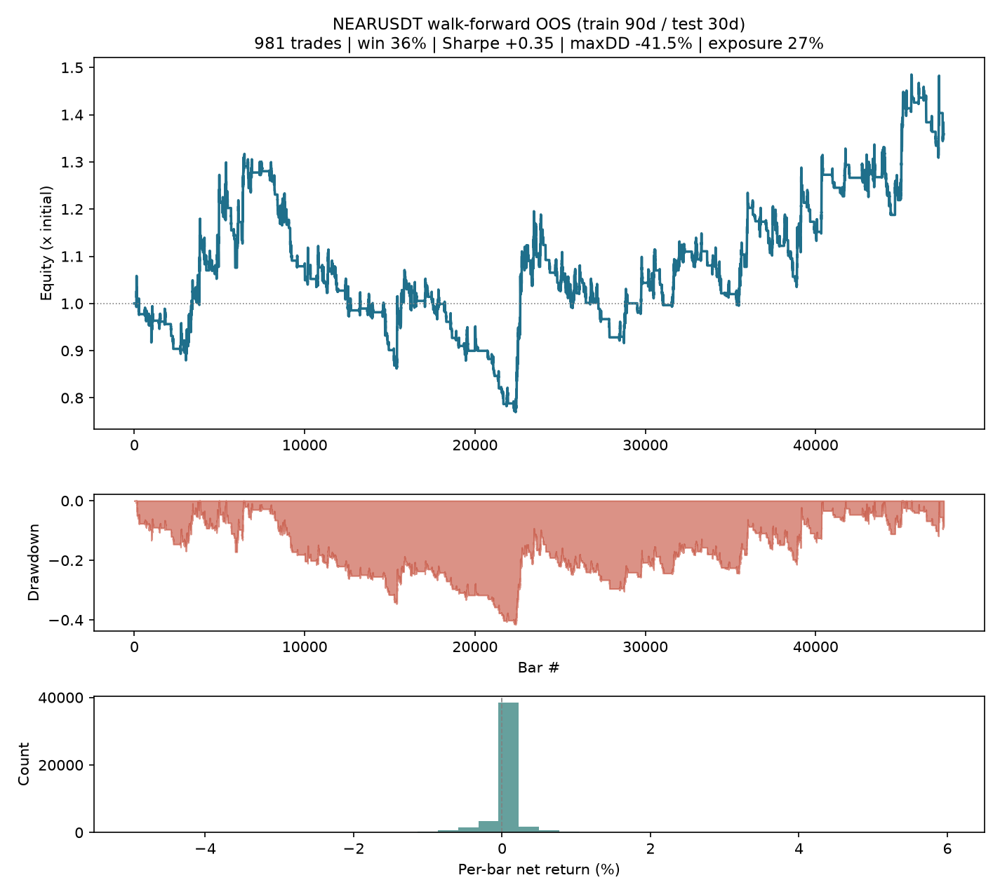
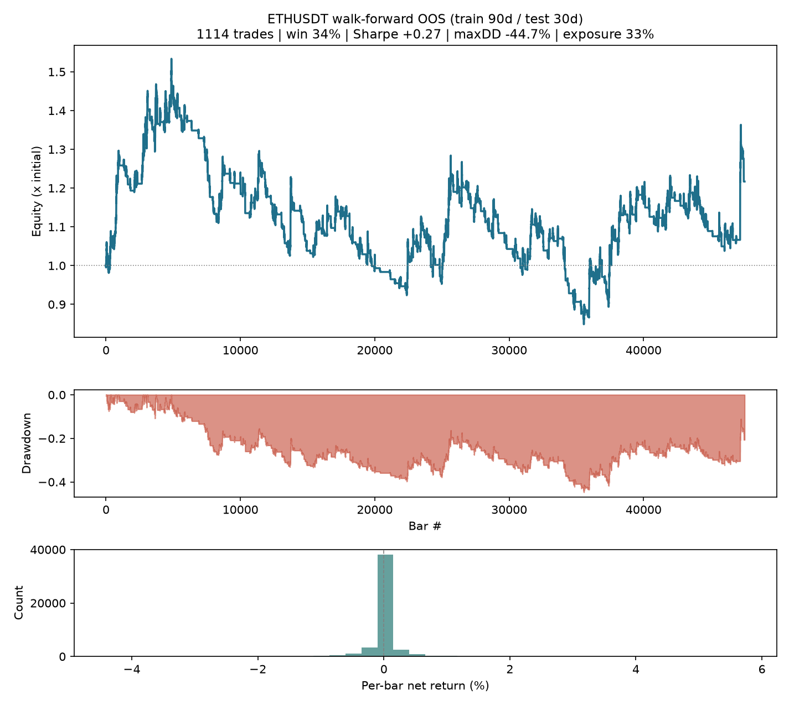
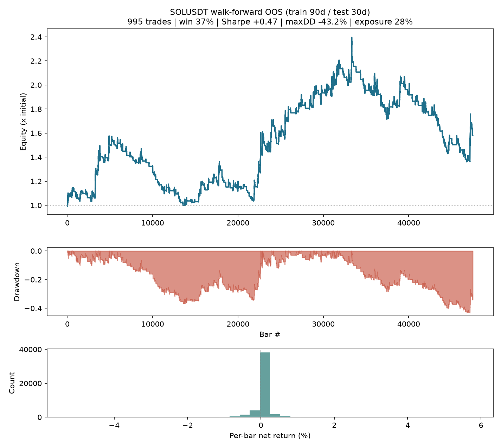
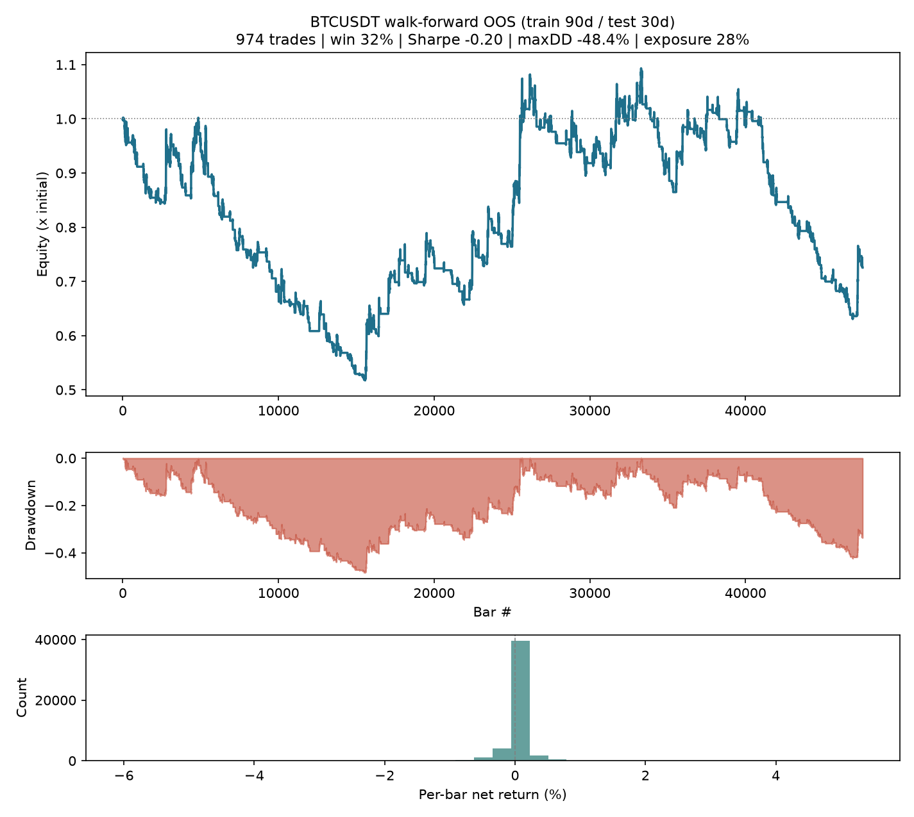
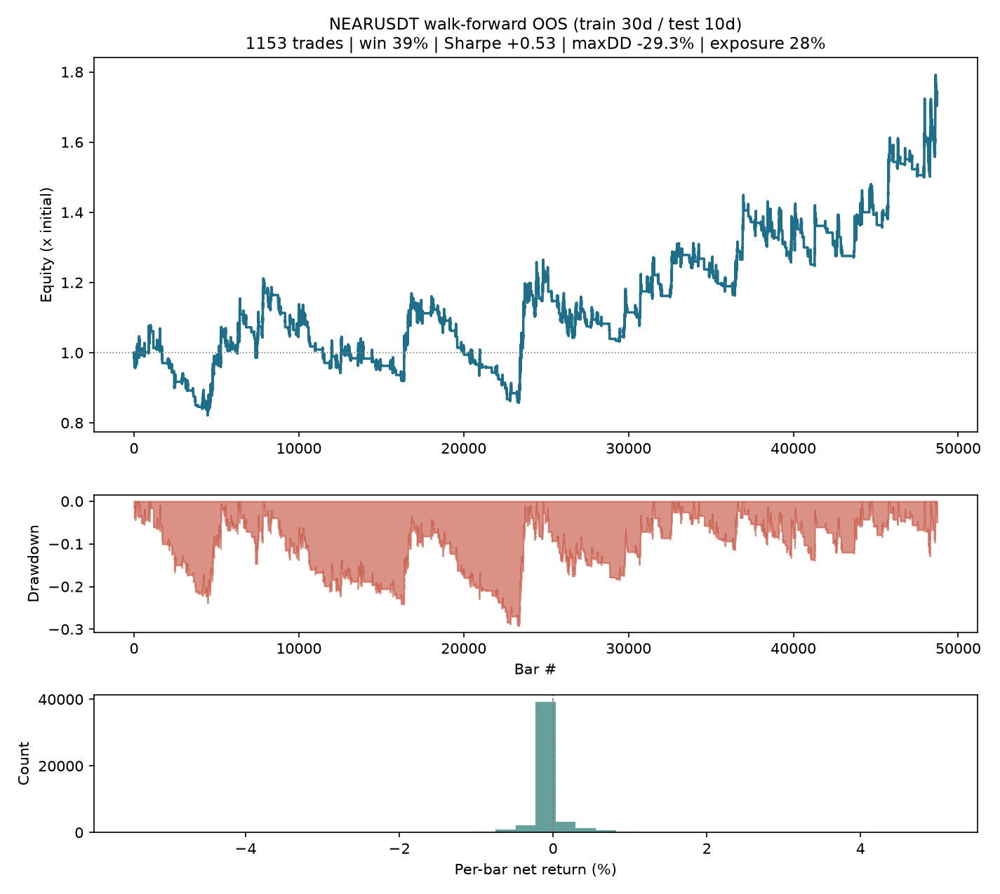
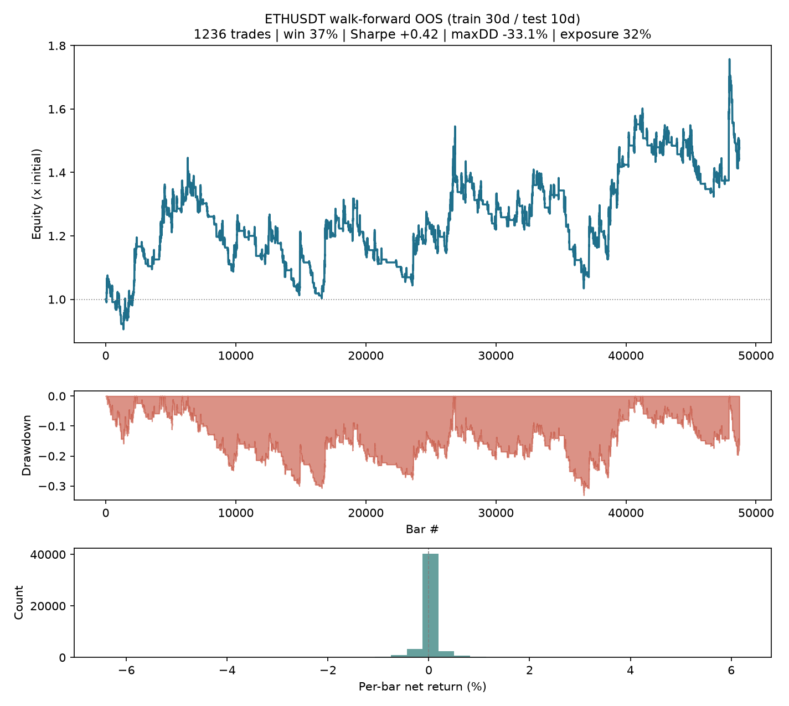
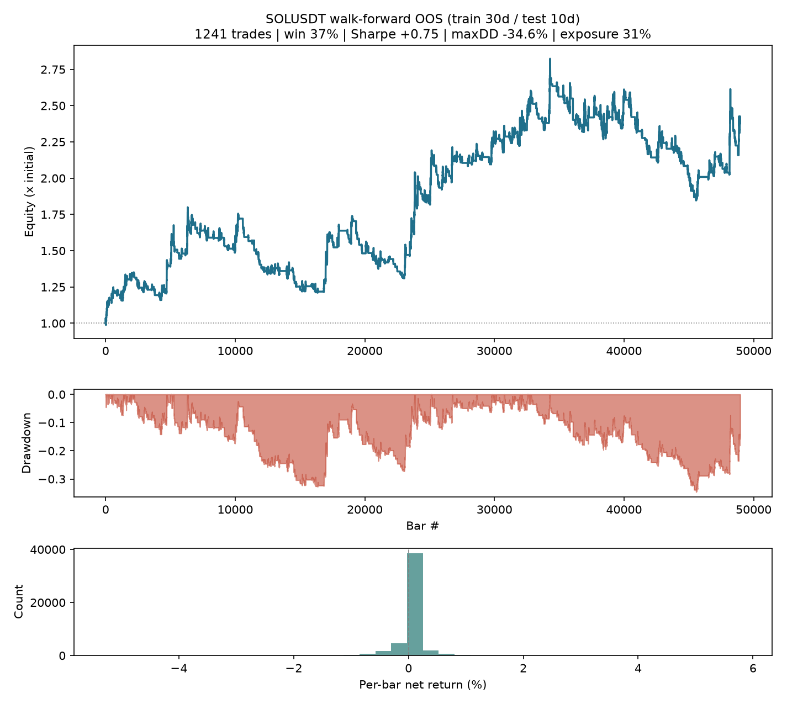
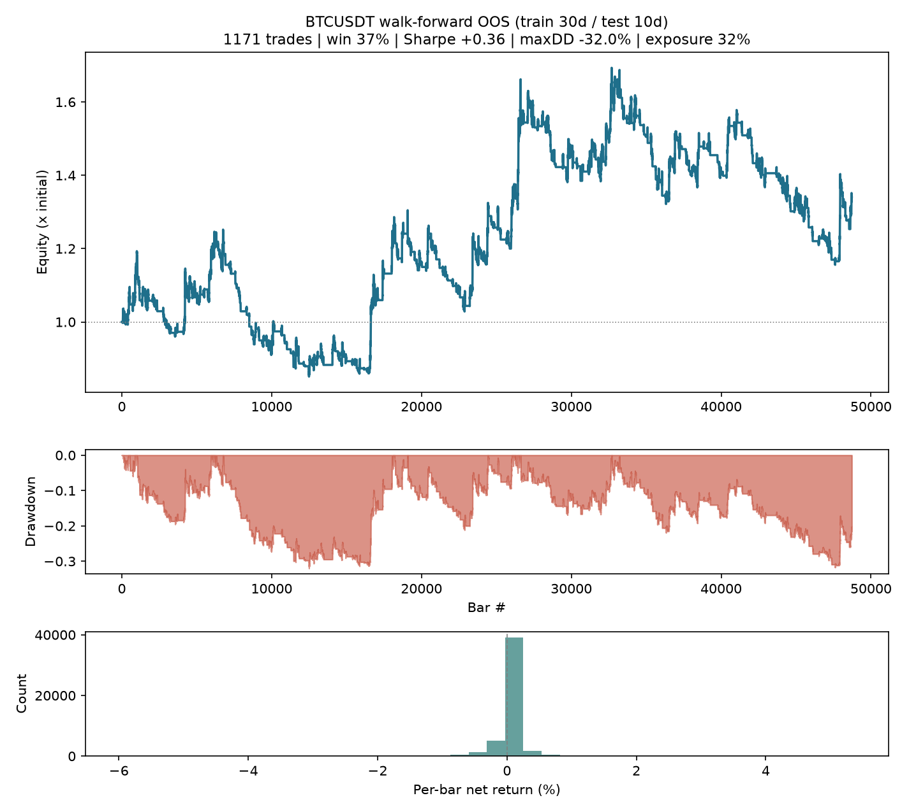

# Validation report

- Data window: `20210101_20261001` (start inclusive, end exclusive), 60m bars aggregated from 1m klines
- Symbols: NEARUSDT, ETHUSDT, SOLUSDT, BTCUSDT
- Engine: walk-forward, Sharpe selection over 12 grid cells, top-3 ensemble; risk overlay OFF (pure engine)
- Costs: taker fee 0.100% + slippage 0.020% per side
- Bootstrap: 10,000 circular-block resamples, block 168 bars, seed 7, 95% percentile CIs
- Deflated Sharpe: N = trials ledger stats.TRIALS_TRIED = 94; trial-Sharpe variance from the 12 grid cells traded as fixed configs on the same OOS bars
- BTC regime: chop if ER(48) < 0.2, else up/down vs SMA(200); label lagged one bar; descriptive only, never a signal

## Window variant: train 90d / test 30d

### NEARUSDT (production)

- OOS bars 47,520, trades 981, **independent decisions N_eff = 331**
- Sharpe (ann.): +0.35  95% CI [-0.50, +1.17]
- Annualised return: +5.81%  95% CI [-13.25%, +29.09%]
- Max drawdown: -41.55%  95% CI [-66.17%, -23.78%]
- Total return: +35.82%
- Expectancy / decision: +0.132%  95% CI [-0.204%, +0.484%]
- Deflated Sharpe: P(SR > SR*) = 0.328, excess over benchmark -0.19 (SR* +0.55 ann., N trials 94)
- Windows: 66/66 traded
- BTC regime at the previous close (descriptive, not a signal):
  - up  :  7,765 bars (16%), return +17.96%, Sharpe +0.70
  - chop: 32,904 bars (69%), return +4.22%, Sharpe +0.16
  - down:  6,851 bars (14%), return +10.48%, Sharpe +0.88
- OOS equity: 
- **Verdict: This result is not statistically distinguishable from noise at this sample size. (Sharpe CI includes zero; annualised-return CI includes zero; per-decision expectancy CI includes zero; deflated Sharpe <= 0 (no excess over the selection-bias benchmark))**

### ETHUSDT

- OOS bars 47,520, trades 1114, **independent decisions N_eff = 357**
- Sharpe (ann.): +0.27  95% CI [-0.62, +1.13]
- Annualised return: +3.68%  95% CI [-14.46%, +26.26%]
- Max drawdown: -44.67%  95% CI [-68.49%, -24.14%]
- Total return: +21.68%
- Expectancy / decision: +0.098%  95% CI [-0.206%, +0.424%]
- Deflated Sharpe: P(SR > SR*) = 0.272, excess over benchmark -0.26 (SR* +0.53 ann., N trials 94)
- Windows: 66/66 traded
- BTC regime at the previous close (descriptive, not a signal):
  - up  :  7,765 bars (16%), return +60.23%, Sharpe +1.51
  - chop: 32,904 bars (69%), return -14.62%, Sharpe -0.14
  - down:  6,851 bars (14%), return -11.05%, Sharpe -2.38
- OOS equity: 
- **Verdict: This result is not statistically distinguishable from noise at this sample size. (Sharpe CI includes zero; annualised-return CI includes zero; per-decision expectancy CI includes zero; deflated Sharpe <= 0 (no excess over the selection-bias benchmark))**

### SOLUSDT

- OOS bars 47,520, trades 995, **independent decisions N_eff = 328**
- Sharpe (ann.): +0.47  95% CI [-0.37, +1.26]
- Annualised return: +8.80%  95% CI [-10.58%, +33.62%]
- Max drawdown: -43.21%  95% CI [-62.49%, -22.43%]
- Total return: +58.02%
- Expectancy / decision: +0.181%  95% CI [-0.166%, +0.552%]
- Deflated Sharpe: P(SR > SR*) = 0.379, excess over benchmark -0.13 (SR* +0.60 ann., N trials 94)
- Windows: 66/66 traded
- BTC regime at the previous close (descriptive, not a signal):
  - up  :  7,765 bars (16%), return -0.24%, Sharpe +0.19
  - chop: 32,904 bars (69%), return +61.98%, Sharpe +0.73
  - down:  6,851 bars (14%), return -2.20%, Sharpe -0.17
- OOS equity: 
- **Verdict: This result is not statistically distinguishable from noise at this sample size. (Sharpe CI includes zero; annualised-return CI includes zero; per-decision expectancy CI includes zero; deflated Sharpe <= 0 (no excess over the selection-bias benchmark))**

### POOLED (equal weight: NEARUSDT + ETHUSDT + SOLUSDT; BTCUSDT excluded)

- OOS bars 47,520, trades 3090, **independent decisions N_eff = 382**
- Sharpe (ann.): +0.49  95% CI [-0.35, +1.30]
- Annualised return: +7.37%  95% CI [-7.11%, +24.64%]
- Max drawdown: -33.96%  95% CI [-49.98%, -16.65%]
- Total return: +47.10%
- Expectancy / decision: +0.120%  95% CI [-0.085%, +0.340%]
- Deflated Sharpe: P(SR > SR*) = 0.323, excess over benchmark -0.20 (SR* +0.69 ann., N trials 94)
- BTC regime at the previous close (descriptive, not a signal):
  - up  :  7,765 bars (16%), return +26.50%, Sharpe +1.01
  - chop: 32,904 bars (69%), return +17.42%, Sharpe +0.37
  - down:  6,851 bars (14%), return -0.97%, Sharpe -0.13
- **Verdict: This result is not statistically distinguishable from noise at this sample size. (Sharpe CI includes zero; annualised-return CI includes zero; per-decision expectancy CI includes zero; deflated Sharpe <= 0 (no excess over the selection-bias benchmark))**

### BTCUSDT (context stream, kept out of the pool)

- OOS bars 47,520, trades 974, **independent decisions N_eff = 320**
- Sharpe (ann.): -0.20  95% CI [-1.20, +0.75]
- Annualised return: -5.74%  95% CI [-21.71%, +14.15%]
- Max drawdown: -48.38%  95% CI [-78.03%, -28.85%]
- Total return: -27.45%
- Expectancy / decision: -0.059%  95% CI [-0.380%, +0.290%]
- Deflated Sharpe: P(SR > SR*) = 0.108, excess over benchmark -0.53 (SR* +0.33 ann., N trials 94)
- Windows: 66/66 traded
- BTC regime at the previous close (descriptive, not a signal):
  - up  :  7,765 bars (16%), return +98.53%, Sharpe +2.08
  - chop: 32,904 bars (69%), return -62.44%, Sharpe -1.97
  - down:  6,851 bars (14%), return -2.69%, Sharpe -1.22
- OOS equity: 
- **Verdict: This result is not statistically distinguishable from noise at this sample size. (Sharpe CI includes zero; annualised-return CI includes zero; per-decision expectancy CI includes zero; deflated Sharpe <= 0 (no excess over the selection-bias benchmark))**

## Window variant: train 30d / test 10d

### NEARUSDT (production)

- OOS bars 48,720, trades 1153, **independent decisions N_eff = 389**
- Sharpe (ann.): +0.53  95% CI [-0.27, +1.28]
- Annualised return: +10.40%  95% CI [-8.32%, +33.38%]
- Max drawdown: -29.28%  95% CI [-59.52%, -21.66%]
- Total return: +73.35%
- Expectancy / decision: +0.181%  95% CI [-0.105%, +0.488%]
- Deflated Sharpe: P(SR > SR*) = 0.390, excess over benchmark -0.12 (SR* +0.65 ann., N trials 94)
- Windows: 203/206 traded
- BTC regime at the previous close (descriptive, not a signal):
  - up  :  8,171 bars (17%), return +9.90%, Sharpe +0.46
  - chop: 33,668 bars (69%), return +49.55%, Sharpe +0.58
  - down:  6,881 bars (14%), return +5.47%, Sharpe +0.56
- OOS equity: 
- **Verdict: This result is not statistically distinguishable from noise at this sample size. (Sharpe CI includes zero; annualised-return CI includes zero; per-decision expectancy CI includes zero; deflated Sharpe <= 0 (no excess over the selection-bias benchmark))**

### ETHUSDT

- OOS bars 48,720, trades 1236, **independent decisions N_eff = 406**
- Sharpe (ann.): +0.42  95% CI [-0.47, +1.29]
- Annualised return: +7.29%  95% CI [-12.28%, +32.03%]
- Max drawdown: -33.07%  95% CI [-66.36%, -23.74%]
- Total return: +47.90%
- Expectancy / decision: +0.138%  95% CI [-0.128%, +0.433%]
- Deflated Sharpe: P(SR > SR*) = 0.345, excess over benchmark -0.17 (SR* +0.59 ann., N trials 94)
- Windows: 203/206 traded
- BTC regime at the previous close (descriptive, not a signal):
  - up  :  8,121 bars (17%), return +82.56%, Sharpe +1.77
  - chop: 33,731 bars (69%), return -11.88%, Sharpe -0.08
  - down:  6,868 bars (14%), return -8.06%, Sharpe -1.75
- OOS equity: 
- **Verdict: This result is not statistically distinguishable from noise at this sample size. (Sharpe CI includes zero; annualised-return CI includes zero; per-decision expectancy CI includes zero; deflated Sharpe <= 0 (no excess over the selection-bias benchmark))**

### SOLUSDT

- OOS bars 48,960, trades 1241, **independent decisions N_eff = 389**
- Sharpe (ann.): +0.75  95% CI [-0.12, +1.58]
- Annualised return: +16.87%  95% CI [-5.33%, +46.10%]
- Max drawdown: -34.61%  95% CI [-59.58%, -22.26%]
- Total return: +138.96%
- Expectancy / decision: +0.274%  95% CI [-0.038%, +0.596%]
- Deflated Sharpe: P(SR > SR*) = 0.553, excess over benchmark +0.06 (SR* +0.69 ann., N trials 94)
- Windows: 204/206 traded
- BTC regime at the previous close (descriptive, not a signal):
  - up  :  8,142 bars (17%), return +11.33%, Sharpe +0.49
  - chop: 33,921 bars (69%), return +130.91%, Sharpe +1.10
  - down:  6,897 bars (14%), return -7.05%, Sharpe -0.69
- OOS equity: 
- **Verdict: This result is not statistically distinguishable from noise at this sample size. (Sharpe CI includes zero; annualised-return CI includes zero; per-decision expectancy CI includes zero)**

### POOLED (equal weight: NEARUSDT + ETHUSDT + SOLUSDT; BTCUSDT excluded)

- OOS bars 49,440, trades 3630, **independent decisions N_eff = 459**
- Sharpe (ann.): +0.74  95% CI [-0.11, +1.56]
- Annualised return: +12.45%  95% CI [-3.52%, +31.96%]
- Max drawdown: -25.73%  95% CI [-46.96%, -16.32%]
- Total return: +93.88%
- Expectancy / decision: +0.169%  95% CI [-0.024%, +0.368%]
- Deflated Sharpe: P(SR > SR*) = 0.429, excess over benchmark -0.08 (SR* +0.81 ann., N trials 94)
- BTC regime at the previous close (descriptive, not a signal):
  - up  :  8,294 bars (17%), return +31.77%, Sharpe +1.08
  - chop: 34,182 bars (69%), return +52.61%, Sharpe +0.80
  - down:  6,964 bars (14%), return -3.59%, Sharpe -0.62
- **Verdict: This result is not statistically distinguishable from noise at this sample size. (Sharpe CI includes zero; annualised-return CI includes zero; per-decision expectancy CI includes zero; deflated Sharpe <= 0 (no excess over the selection-bias benchmark))**

### BTCUSDT (context stream, kept out of the pool)

- OOS bars 48,720, trades 1171, **independent decisions N_eff = 399**
- Sharpe (ann.): +0.36  95% CI [-0.56, +1.24]
- Annualised return: +5.41%  95% CI [-12.33%, +28.06%]
- Max drawdown: -32.02%  95% CI [-65.53%, -22.70%]
- Total return: +34.06%
- Expectancy / decision: +0.110%  95% CI [-0.171%, +0.399%]
- Deflated Sharpe: P(SR > SR*) = 0.471, excess over benchmark -0.03 (SR* +0.39 ann., N trials 94)
- Windows: 203/206 traded
- BTC regime at the previous close (descriptive, not a signal):
  - up  :  8,244 bars (17%), return +140.91%, Sharpe +2.45
  - chop: 33,635 bars (69%), return -44.77%, Sharpe -1.00
  - down:  6,841 bars (14%), return +0.76%, Sharpe +0.42
- OOS equity: 
- **Verdict: This result is not statistically distinguishable from noise at this sample size. (Sharpe CI includes zero; annualised-return CI includes zero; per-decision expectancy CI includes zero; deflated Sharpe <= 0 (no excess over the selection-bias benchmark))**

## Verdict

- train 90d / test 30d | NEARUSDT (production): This result is not statistically distinguishable from noise at this sample size. (Sharpe CI includes zero; annualised-return CI includes zero; per-decision expectancy CI includes zero; deflated Sharpe <= 0 (no excess over the selection-bias benchmark))
- train 90d / test 30d | ETHUSDT: This result is not statistically distinguishable from noise at this sample size. (Sharpe CI includes zero; annualised-return CI includes zero; per-decision expectancy CI includes zero; deflated Sharpe <= 0 (no excess over the selection-bias benchmark))
- train 90d / test 30d | SOLUSDT: This result is not statistically distinguishable from noise at this sample size. (Sharpe CI includes zero; annualised-return CI includes zero; per-decision expectancy CI includes zero; deflated Sharpe <= 0 (no excess over the selection-bias benchmark))
- train 90d / test 30d | POOLED (equal weight: NEARUSDT + ETHUSDT + SOLUSDT; BTCUSDT excluded): This result is not statistically distinguishable from noise at this sample size. (Sharpe CI includes zero; annualised-return CI includes zero; per-decision expectancy CI includes zero; deflated Sharpe <= 0 (no excess over the selection-bias benchmark))
- train 90d / test 30d | BTCUSDT (context stream, kept out of the pool): This result is not statistically distinguishable from noise at this sample size. (Sharpe CI includes zero; annualised-return CI includes zero; per-decision expectancy CI includes zero; deflated Sharpe <= 0 (no excess over the selection-bias benchmark))
- train 30d / test 10d | NEARUSDT (production): This result is not statistically distinguishable from noise at this sample size. (Sharpe CI includes zero; annualised-return CI includes zero; per-decision expectancy CI includes zero; deflated Sharpe <= 0 (no excess over the selection-bias benchmark))
- train 30d / test 10d | ETHUSDT: This result is not statistically distinguishable from noise at this sample size. (Sharpe CI includes zero; annualised-return CI includes zero; per-decision expectancy CI includes zero; deflated Sharpe <= 0 (no excess over the selection-bias benchmark))
- train 30d / test 10d | SOLUSDT: This result is not statistically distinguishable from noise at this sample size. (Sharpe CI includes zero; annualised-return CI includes zero; per-decision expectancy CI includes zero)
- train 30d / test 10d | POOLED (equal weight: NEARUSDT + ETHUSDT + SOLUSDT; BTCUSDT excluded): This result is not statistically distinguishable from noise at this sample size. (Sharpe CI includes zero; annualised-return CI includes zero; per-decision expectancy CI includes zero; deflated Sharpe <= 0 (no excess over the selection-bias benchmark))
- train 30d / test 10d | BTCUSDT (context stream, kept out of the pool): This result is not statistically distinguishable from noise at this sample size. (Sharpe CI includes zero; annualised-return CI includes zero; per-decision expectancy CI includes zero; deflated Sharpe <= 0 (no excess over the selection-bias benchmark))

**Overall: This result is not statistically distinguishable from noise at this sample size.**

---
Noise clause (DESIGN.md §7.6): any block whose CI includes zero, whose deflated Sharpe does not beat the selection-bias benchmark, or whose N_eff is too small for an expectancy CI is not statistically distinguishable from noise at this sample size, and is reported as such. DSR charges for every configuration tried (stats.TRIALS_TRIED).

Not financial advice.